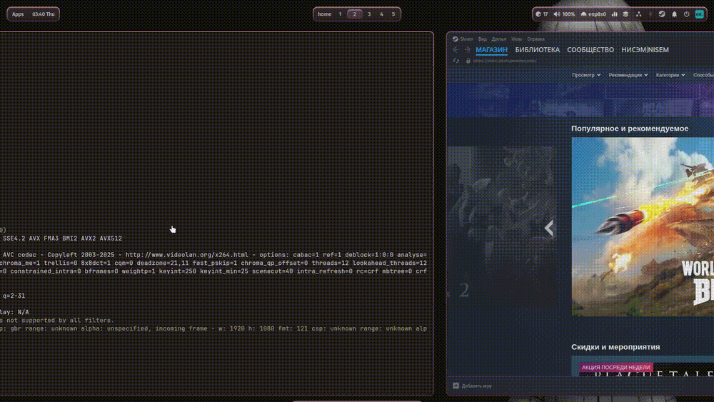

# Infinite tiling for Hyprland (ml4w-friendly)

Infinite tiling and an optional home workspace using Hyprland's official Lua API.
No binary patches. Config survives updates.

[](https://hypr.land)
[](LICENSE)
[](https://cachyos.org)
[](https://github.com/nisem-off/infinite-tiling-hyprland/releases)

---

> **Status:** beta. Core functionality is stable, minor bugs may occur — please open an issue if you find one.

## 🎬 Demo



---

## ✨ What it does

- **Infinite tiling**: new windows open on the next free workspace (max_id + 1).
- **Compaction on close**: close a window on workspace 2, and windows from 3 and 4 move to 2 and 3. No gaps left behind.
- **Focus stays put**: you remain on the workspace you were on when you closed the window.
- **Dialogs and floating windows untouched**: `pavucontrol`, `nm-connection-editor`, portals, and Steam popups are ignored during compaction.
- **Optional home workspace**: an empty widget workspace, windows start at workspace 2.

## 🧐 Why not Niri?

Niri offers a similar UX but requires switching your entire environment. Here, Hyprland stays Hyprland: it uses the official `hl.*` API, doesn't patch the binary, and the config survives updates. If you've already set up ml4w, you lose nothing.

## 📋 Requirements

| Component | Version | Required? |
|---|---|---|
| **Hyprland** | ≥ 0.55 (tested on 0.56.2) | Yes |
| **Waybar** | ≥ 0.15.0 (tested on 0.15.0) | Optional (for the workspaces module) |
| **ML4W** | 2.16.1 | Optional |
| **OS** | Arch-based (tested on CachyOS) | — |

> Lua config (`custom.lua`, `input.lua`) is supported since Hyprland 0.55. ML4W 2.13+ automatically sources `~/.config/hypr/custom.lua`, no extra configuration needed.

## 🚀 Installation (drop-in)

```bash
# 1. Copy the files
cp custom.lua input.lua ~/.config/hypr/
cp modules-custom.json ~/.config/waybar/   # if you use waybar

# 2. If you're NOT on ML4W 2.13+, add to ~/.config/hypr/hyprland.conf:
# source = ~/.config/hypr/custom.lua
# source = ~/.config/hypr/input.lua

# 3. Reload
hyprctl reload
```

**Works out of the box.** The home workspace is disabled by default — windows start at Workspace 1.

## 🛤️ Two paths

### Path A — no home (default)

Nothing to do. Windows start at Workspace 1, compaction works, focus stays put.

### Path B — with home workspace

1. In `custom.lua`, uncomment the `[OPTIONAL] HOME WORKSPACE` block.
2. In `modules-custom.json`, in the `hyprland/workspaces` section, uncomment `"sort-by": "id"` and `"format": "{name}"`.
3. Make sure your `hyprland.conf` `SUPER+1..5` binds point to the right workspaces.

> **Important:** enable both blocks together. Otherwise you get a "half-home": rules work, but Waybar shows the wrong thing.

## ⚙️ How it works

```
window.close
  → remember active_ws
  → 250 ms timer
  → compact_workspaces()
      ├─ group windows by ws_id
      ├─ detect gaps (ws_id ≠ position)
      ├─ move with follow = false
      └─ focus back to active_ws
```

**Why `follow = false`:** otherwise focus jumps to the window being moved.
**Why 250 ms:** Hyprland removes the window from `get_windows()` asynchronously. Below 200 ms you might catch a "ghost".

## 🔧 Configuration

| Parameter | File | Default | What it does |
|---|---|---|---|
| `timeout` | `custom.lua` | 250 | Delay before compaction (ms) |
| `follow` | `custom.lua` | `false` | Must stay `false` |
| `class` regex in `keep-dialogs-here` | `custom.lua` | portal / pavucontrol / nm | Which dialogs not to compact |
| Steam popup skip | `custom.lua` | — | Ignore Steam floating windows |

## ⚠️ Known limitations

- The 250 ms delay feels like a "breath" on close — by design.
- Steam popups are ignored when counting occupancy. If another launcher behaves similarly, add it to `is_steam_popup`.
- Chromium PWAs are treated as regular windows (intentional exception).
- The home workspace must be enabled in two files consistently.

## 🩺 Troubleshooting

| Symptom | Cause | Fix |
|---|---|---|
| Focus jumps on close | `follow = false` not applied | Make sure you're using the repo script, not an old one |
| Windows don't compact | Hyprland < 0.55 or `hl.on` unsupported | Update Hyprland |
| Waybar shows wrong names | Home enabled in Lua but not in Waybar | Path B, step 2 |
| `pavucontrol` moved to another ws | Missing from `keep-dialogs-here` | Add its class |
| New window didn't open on max+1 | It's floating and not a PWA | Intentional |

## 🗺️ Roadmap

- [ ] Option "don't compact if a single fullscreen window remains"
- [ ] Rule for browser PiP windows
- [ ] Config flag instead of commenting blocks
- [ ] Test on Hyprland ≥ 0.57

## 🙏 Credits

- [Hyprland](https://hypr.land) — for the Lua API
- [ML4W](https://github.com/mylinuxforwork/dotfiles) — for the base config
- [Niri](https://github.com/YaLTeR/niri) — for the UX that inspired this
- You — for building it

## 📄 License

MIT © 2025
